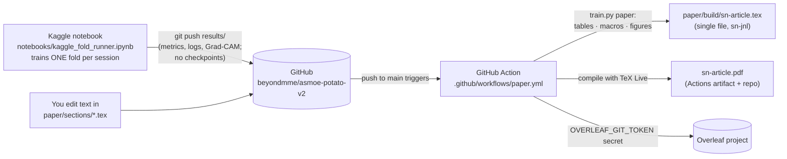
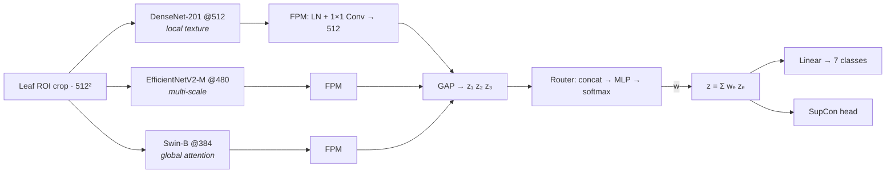

 # ASMOE V2 · Potato Leaf Disease Classification in Uncontrolled Environments

**Adaptive Soft Mixture-of-Experts** with heterogeneous backbones (DenseNet-201 · EfficientNetV2-M · Swin-B),
a leakage-free data pipeline, and a manuscript in the **Springer Nature LaTeX template** whose numbers,
tables and figures are regenerated automatically from every training run.

> **Status:** code, Kaggle runner, paper pipeline and CI are in place and tested end to end on CPU with
> synthetic data. The real 5-fold GPU runs have not been executed yet, so the ASMOE V2 numbers in the paper
> show "—" until the first fold is pushed.

---

## How the pieces connect



* **Source of truth = this repository.** Text lives in `paper/sections/`, title and authors in
  `paper/template/sn-article.tex`, numbers in `results/`.
* `paper/build/` is **generated**: one self-contained `sn-article.tex` (the template forbids `\input`) plus
  `figures/`, `sn-bibliography.bib`, `sn-jnl.cls` and `sn-mathphys-num.bst`. This folder is exactly what the
  Overleaf project should contain. Don't edit it in Overleaf, because the next sync overwrites it.

## One-time setup (≈ 10 minutes)

### 1 · GitHub token for Kaggle → GitHub pushes
1. <https://github.com/settings/personal-access-tokens/new> (fine-grained token)
2. Repository access: **Only select repositories** → `asmoe-potato-v2`
3. Permissions → Repository → **Contents: Read and write** → *Generate token* and copy it

### 2 · Kaggle notebook
1. Kaggle → *Create* → *New Notebook* → *File* → *Import Notebook* → **GitHub** tab →
   `beyondmme/asmoe-potato-v2` → `notebooks/kaggle_fold_runner.ipynb`
2. *Add Input* → search `potato leaf disease uncontrolled` → add **warcoder/potato-leaf-disease-dataset**
3. *Settings*: Accelerator **GPU T4 ×1**, **Internet on**
4. *Add-ons* → *Secrets* → *Add secret*: label `GITHUB_TOKEN`, value = token from step 1 → tick it for this notebook

### 3 · Overleaf (pick one)
* **Overleaf paid / institutional plan (automatic):** Overleaf → *Account Settings* → *Git integration* →
  *Generate token*. Then on GitHub: repo → *Settings* → *Secrets and variables* → *Actions* →
  *New repository secret* `OVERLEAF_GIT_TOKEN`. The project URL defaults to
  `https://git.overleaf.com/6ae6eb411f26b6a0c2f760f8`; to use another project, add a repository
  *variable* `OVERLEAF_GIT_URL`. Every Action run then pushes the manuscript into Overleaf.
* **Free plan (manual, 1 minute per update):** open the latest run under the repo's *Actions* tab, download
  the **overleaf-upload** artifact, and in Overleaf use *New Project → Upload Project* (or upload the files into
  the existing project). Overleaf's Git integration is a paid feature, so it cannot be automated on a free plan.

## Training on a lab GPU (recommended: RTX 4090)

A T4 on Kaggle needs about 510 s per Stage-1 epoch for this 160 M-parameter mixture, which is too slow for
12-hour sessions. On an RTX 4090 (24 GB, bf16) use `configs/asmoe_v2_rtx4090.yaml`. It is the same model and
protocol, without gradient checkpointing and without a time budget.

```bash
conda env create -f environment.yml
```

```bash
conda activate asmoe
```

```bash
python scripts/check_env.py --data "D:/data/Potato Leaf Disease Dataset in Uncontrolled Environment" --probe
```

```bash
python train.py train --config configs/asmoe_v2_rtx4090.yaml --set data.root="D:/data/Potato Leaf Disease Dataset in Uncontrolled Environment" --push
```

`--push` trains folds 0–4 one after another. After each finished fold it renders Grad-CAM (fold 0), copies the
results to `results/`, and commits and pushes them, so the paper on GitHub/Overleaf updates while training
continues. If you stop the run (Ctrl+C), the same command resumes the unfinished fold from `resume.pt` and skips
finished ones.

## Training on RunPod (rented GPU)

1. Pick an **RTX 4090 Community Cloud** pod with the **RunPod PyTorch 2.x** template, a 20 GB container disk
   and a 30 GB volume. Set the environment variables `GITHUB_TOKEN`, `KAGGLE_USERNAME` and `KAGGLE_KEY`
   (ideally as `{{ RUNPOD_SECRET_... }}` references).
2. In the pod's web terminal:

   ```bash
   cd /workspace && git clone https://github.com/beyondmme/asmoe-potato-v2.git && bash asmoe-potato-v2/scripts/runpod/setup.sh
   ```

   ```bash
   cd /workspace/asmoe-potato-v2 && bash scripts/runpod/train.sh
   ```

`train.sh` runs inside tmux, so closing the browser is safe. It pushes every finished fold to GitHub and
**stops the pod when training ends** (`AUTO_STOP=0` disables this). Stopping ends GPU billing. Terminate the pod
once the results are on GitHub, so you don't pay for the stopped volume. Re-running `train.sh` resumes
unfinished folds.

## Running the experiments on Kaggle

| Kaggle version | Parameters (first code cell) |
|---|---|
| 1–5 | `FOLD = 0` … `4`. Every finished fold is pushed to GitHub and the paper rebuilds itself |
| if a fold prints `PAUSED` | new version with the **same `FOLD`**, attach the previous version's output as input |
| single-expert baselines | `EXPERIMENT = "single_swinb"`, `EXPERT = "swin_base_patch4_window12_384.ms_in22k_ft_in1k"` (see `configs/paper_experiments.yaml`) |
| ablations | e.g. `EXPERIMENT = "abl_no_roi"`, `EXTRA_OVERRIDES = ["data.roi_crop=false"]` |

Each session prints a time estimate per fold before training. Training pauses cleanly before
`TIME_BUDGET_HOURS` (default 10.5 h) and keeps `resume.pt`. This matters because Kaggle discards all outputs
of a run that hits the 12 h limit. Fold 0 of the main model also renders Grad-CAM panels for the paper.

**Compute budget.** ASMOE V2 has 160.7 M parameters and processes three resolutions per image. Expect several
GPU-hours per fold on a T4. The full suite (main + 3 single experts + 7 ablations, × 5 folds) does not fit
Kaggle's weekly quota. Run ablations at 384 px (`EXTRA_OVERRIDES += ["data.image_size=384"]`) or on fewer folds.

## What the legacy audit found

| Model (legacy) | Split | Accuracy (%) | Macro-F1 (%) |
|---|---|---|---|
| MobileViT-S | random (duplicates leak) | 89.89 ± 1.69 | 88.16 ± 2.68 |
| EfficientNet-B0 | random | 86.87 ± 1.99 | 85.03 ± 3.27 |
| EffNet+MobileViT ECA-gated | group-aware | 83.55 ± 2.20 | 82.12 ± 2.67 |
| **MobileViT-S (reference baseline)** | **group-aware** | **84.92 ± 1.27** | **83.68 ± 1.42** |
| ASMOE V2 (ours) | group-aware, cleaned | *pending* | *pending* |

* **Imbalance 11×**: Fungi 748 vs. Nematode 68. Legacy Nematode errors are mostly false positives (precision 67 %, recall 90 %).
* **Duplicates**: 55 byte-identical groups. **6 carry conflicting labels, and all 6 involve Pest**. 38 redundant Phytophthora copies; 27 near-duplicate bursts.
* **Confusions**: Pest→Fungi 76, Fungi→Pest 69, Phytophthora→Fungi 31, Pest→Healthy 27, Pest→Virus 26.
* **CutMix**: 57.89 % vs. 70.89 % Macro-F1 without augmentation (fold-1 screen); Nematode recall 3.1 %.
* **Under-training**: the best epochs were 12, 14, 13, 13 and 9 under a 14-epoch cap.

## Architecture



Two-stage refinement: (1) frozen backbones, FPM + router + head at 3e-4; (2) all layers with discriminative
learning rates (backbone 1e-5, head 3e-4), AMP, EMA and early stopping on Macro-F1. Data: SHA-256/dHash
deduplication, conflicting labels removed, `StratifiedGroupKFold`, HSV/excess-green leaf ROI, flips, ±20°
rotation, mild affine, ColorJitter 0.15 and MixUp α = 0.2 (no CutMix).

## Repository layout

```
├── .github/workflows/paper.yml   # results/ → manuscript → PDF → Overleaf
├── train.py                      # CLI: audit-legacy · prepare · train · suite · gradcam · export · paper
├── configs/                      # asmoe_v2.yaml, asmoe_v2_large.yaml, paper_experiments.yaml, smoke_test.yaml
├── src/
│   ├── dataset.py  trainer.py  losses.py  metrics.py  results.py  config.py
│   ├── models/asmoe.py
│   └── utils/  manuscript.py  overleaf_sync.py  github_sync.py  latex_tables.py  plots.py  gradcam.py  legacy_audit.py
├── notebooks/  kaggle_fold_runner.ipynb  pipeline_demo.ipynb
├── results/                      # committed, light: legacy audit + one folder per experiment/fold
├── paper/
│   ├── template/sn-article.tex   # Springer Nature skeleton (title, authors, section order)
│   ├── sections/*.tex            # the text you write
│   ├── sn-bibliography.bib
│   └── build/                    # GENERATED: Overleaf-ready single-file manuscript + figures + PDF
├── scripts/  check_tex.py  build_notebook.py  build_kaggle_notebook.py
└── tests/    test_smoke.py  simulate_kaggle.py
```

## Local use

```bash
pip install -r requirements.txt
```

```bash
python train.py paper          # rebuild paper/build/ from results/ (no GPU, no PyTorch needed)
```

```bash
python scripts/check_tex.py    # static LaTeX checks (labels, cites, macros, figures)
```

```bash
python tests/test_smoke.py     # CPU smoke test of data, model, trainer and report (~2 min)
```

```bash
python tests/simulate_kaggle.py   # replays Kaggle sessions → push → paper build against a local bare repo
```

Sentences in the results whose direction depends on the final numbers are wrapped in `\checkclaim{...}`
(orange in the PDF). Confirm or rewrite them, then set `\checkclaimdraftfalse` in
`paper/template/sn-article.tex` before submission.

## Citation

```bibtex
@misc{asmoe_v2_potato_2026,
  title        = {ASMOE V2: Heterogeneous Mixture-of-Experts with Adaptive Soft Routing for
                  Potato Leaf Disease Classification in Uncontrolled Environments},
  author       = {<Author Names>},
  year         = {2026},
  howpublished = {\url{https://github.com/beyondmme/asmoe-v2}}
}
```

Builds on ASMoE (Hoang & Phan, *Array* 32 (2026) 101261) and the dataset of Shabrina et al.,
*Data in Brief* 52 (2024) 109955.

## License

Code: MIT (see [LICENSE](LICENSE)). `paper/template/sn-jnl.cls` and the `.bst` file are Springer Nature's
template files (LPPL). The dataset is subject to its own license.
